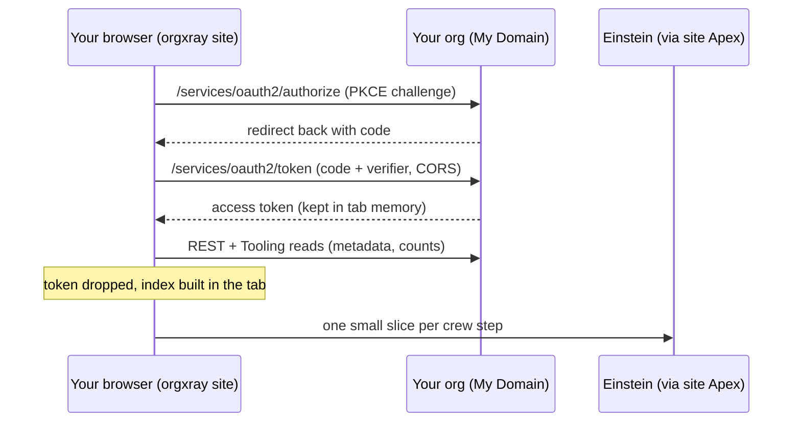

# Org X-Ray

Connect a Salesforce org, and watch an AI crew dig through it in 3D to work out how the business really runs. Then ask the crew anything, in plain words or technical detail.

Built entirely on Salesforce: Experience Cloud (LWR), Lightning Web Components, Apex and the Einstein Models API.

**Live site:** https://orgfarm-bd59095f65-dev-ed.develop.my.site.com/watchitbuild/

> Status: phases 0–2 are live (3D dig, real AI investigation, upload your own org). See [docs/BUILD_PLAN.md](docs/BUILD_PLAN.md).

## How it works

```
Visitor's browser (public LWR site)                 watchitbuild org
  metadata index + agent tools + 3D scene  ──JSON──▶  guest Apex ──▶ Einstein Models API
  (the visitor's org data stays here)      ◀──JSON──  checks every model response
```

- The visitor's org data never leaves their browser. Our org stores no scans.
- The model only proposes the next step. Apex checks every response against a fixed contract, and the tools are plain code that only reads.

## Investigate your own org

On the site, press **Use your org**. Use a sandbox or dev org. There are two ways in:

**Sign in (recommended).** Your admin does a one-time setup: in Setup › CORS, add the site's origin and tick **Enable CORS for OAuth endpoints**. Then enter your My Domain and sign in. The site uses OAuth 2.0 with PKCE as a public client with no secret. The code is exchanged at your own My Domain, straight from your browser, so the token never reaches our server. It stays in the tab's memory, is used once to read metadata and record _counts_ (never records), and is then dropped.



**Upload a zip.** Run the `sf` command the panel shows (it exports metadata only), then choose the `orgxray.zip` it creates. The zip is read in your browser tab and is never uploaded or stored.

Either way, while the crew works, only the pieces it reads are sent to the AI, one step at a time.

## Project layout

| Path                                        | What                                               |
| ------------------------------------------- | -------------------------------------------------- |
| `force-app/main/default/lwc`                | Lightning Web Components                           |
| `force-app/main/default/classes`            | Apex (guest controllers, model client, validation) |
| `force-app/main/default/digitalExperiences` | The public LWR site                                |
| `scripts/smoke/guest-smoke.mjs`             | Logged-out smoke test of the live site             |
| `.github/workflows/ci.yml`                  | CI: lint, tests, validate on PR, deploy on `main`  |
| `docs/BUILD_PLAN.md`                        | Plan, phases and decisions                         |

## Local commands

```bash
npm install
npm run lint && npm run prettier:verify && npm test
sf project deploy start --source-dir force-app --test-level RunLocalTests --target-org watchitbuild
sf community publish --name watchitbuild --target-org watchitbuild
node scripts/smoke/guest-smoke.mjs https://orgfarm-bd59095f65-dev-ed.develop.my.site.com/watchitbuild/
```

## CI setup

CI needs one repository secret, `SFDX_AUTH_URL`, for the `watchitbuild` org:

```bash
sf org display --target-org watchitbuild --verbose --json | jq -r .result.sfdxAuthUrl | gh secret set SFDX_AUTH_URL --repo pratiks2003/watchitbuild
```

The workflow refuses to run against any other org.
